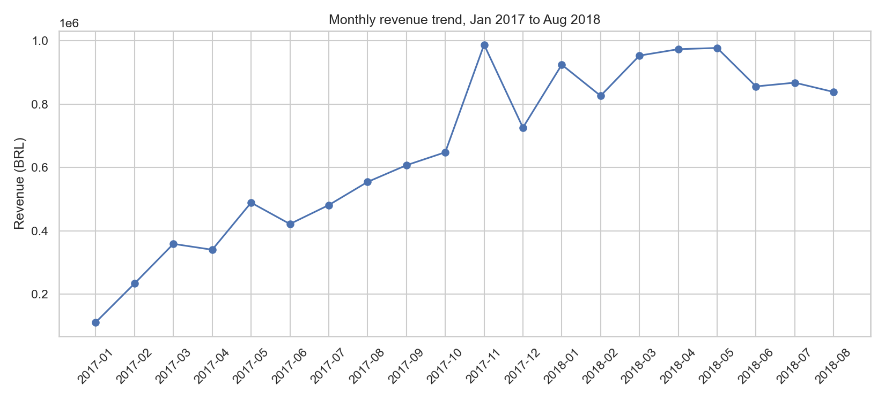
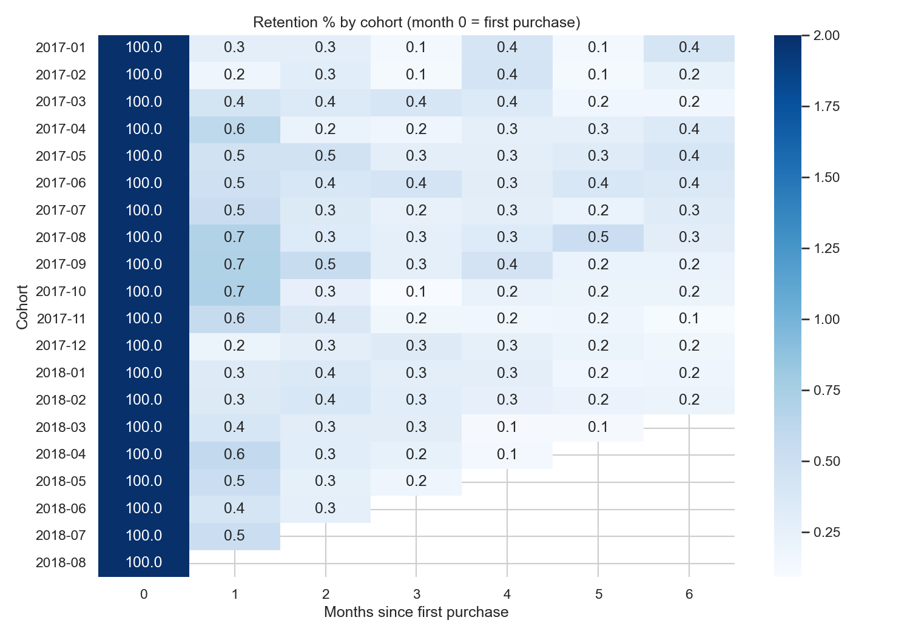
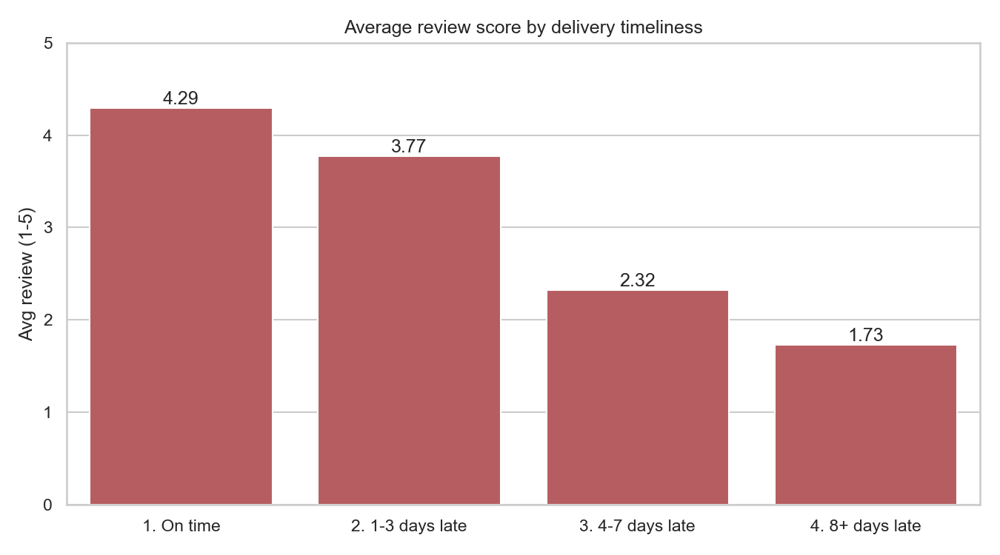
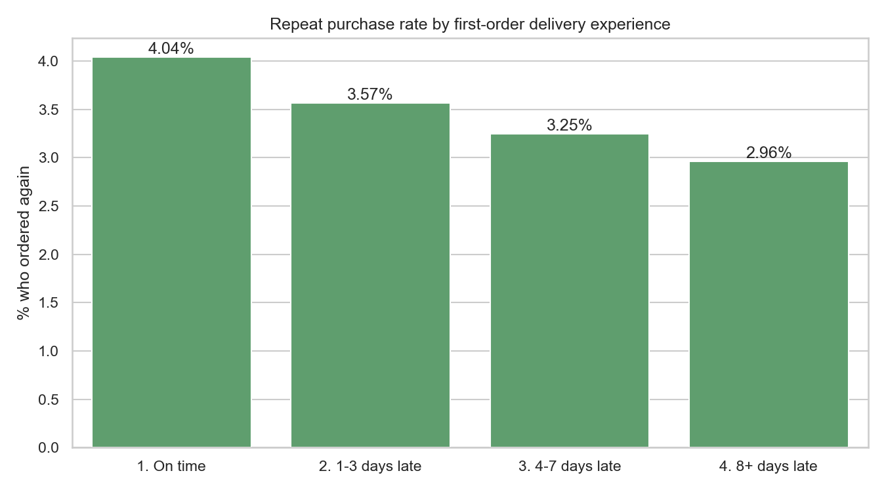

# Olist Customer Retention & Revenue Analysis

**Business question:** Olist's revenue grew rapidly, but are customers coming back, and what is hurting satisfaction and repeat purchases?

**Tools:** SQL (SQLite: CTEs, window functions, joins), Python (pandas, matplotlib, seaborn)

**Dataset:** [Brazilian E-Commerce Public Dataset by Olist](https://www.kaggle.com/datasets/olistbr/brazilian-ecommerce) (~100K orders, 8 relational tables, 2016-2018)

## Key findings

1. **Growth came from order volume, not basket size.** Monthly revenue rose from R$112K (Jan 2017) to R$839K (Aug 2018), about 7.5x, as orders grew from 750 to 6,351 per month. Average order value stayed in the R$125-150 range. Revenue peaked in Nov 2017 (R$988K) and then plateaued at roughly R$830-980K per month through 2018.
2. **Almost nobody comes back.** Only about 3% of customers (2,801 of 93,357) placed more than one order. The other 97% generated about 94% of revenue, so the business depends on constantly acquiring new customers.
3. **The money is in high-value one-time buyers.** "New High-Value" (14,428 customers, avg R$302) and "At Risk High-Value" (13,757 customers, avg R$308) together account for about 56% of revenue. "Champions" and "Loyal" customers together are 3% of customers and 5.6% of revenue.
4. **Late delivery sharply hurts reviews.** On-time orders averaged 4.29 stars with 9.2% bad reviews (1-2 stars). For orders 8+ days late, the average was 1.73 stars with 78.3% bad reviews. Reviews already collapse at 4-7 days late (2.32 stars, 61.3% bad).
5. **Late first deliveries reduce repeat purchases, but the effect is modest.** Customers whose first order arrived on time reordered at 4.04%, versus 2.96% for those 8+ days late (about 27% lower). Even on-time customers rarely return, so delivery is not the main cause of low retention.

## Recommendations

1. **Convert high-value first-time buyers into second purchases.** 14,428 "New High-Value" customers average R$302 and make up 28% of revenue. Test a post-purchase campaign in the first 30-60 days (replenishment or related-product offers). *Estimate: each +1 percentage point of repeat conversion is about 144 customers, or about R$44K at their average spend.*
2. **Run a win-back test on "At Risk High-Value" customers.** 13,757 customers represent R$4.2M in historical revenue at an average of R$308. *Illustrative estimate: reactivating 2% would bring back about 275 customers, or about R$85K.* Validate with an A/B test before committing budget.
3. **Protect reviews by reducing severe lateness and setting realistic delivery estimates.** Bad reviews jump from 19% (1-3 days late) to 61% (4-7 days late). Prioritize the 4+ days late orders, for example through proactive customer notifications and more accurate estimated dates. *Estimate: closing the repeat-rate gap for late first orders would add only about 35 repeat customers in the analyzed cohort, so this is mainly a reputation and review-quality fix, not a retention fix.*

## Approach

| Analysis | File |
|---|---|
| Monthly revenue, AOV, MoM growth | `sql/01_monthly_revenue.sql` |
| Cohort retention | `sql/02_cohort_retention.sql` |
| RFM segmentation | `sql/03_rfm_segmentation.sql` |
| Delivery timeliness vs review score | `sql/04_delivery_vs_reviews.sql` |
| First-order delivery vs repeat purchase | `sql/05_first_order_delivery_repeat.sql` |

## Data notes

- Used `customer_unique_id`, not `customer_id`, which is regenerated for every order.
- Aggregated payments and items to one row per order before joining, to avoid inflating revenue.
- Revenue trend uses item price (excluding freight), Jan 2017 to Aug 2018, delivered orders only. RFM uses total payment value (including freight) over the full dataset, so the two revenue totals are not directly comparable.
- RFM frequency uses fixed rules, not quintiles, because about 97% of customers ordered once.
- The repeat-purchase query only includes first orders before March 2018, so customers had time to return.
- Review analysis covers only delivered orders that have a review.

## Limitations

- Late delivery and low repeat rates are associated, not proven causal. Late orders may differ in other ways (region, category, seller).
- The 8+ days late group is small (1,995 customers, roughly 59 repeat buyers), so its repeat rate is imprecise.
- Review analysis only includes customers who chose to leave a review, so there may be selection bias.
- Impact estimates in the recommendations are simple illustrations, not forecasts.

## How to reproduce

1. Download the dataset from Kaggle into `data/raw/`
2. `pip install -r requirements.txt`
3. `python3 load_data.py`
4. Run `notebooks/analysis.ipynb`